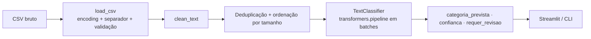

# 🗂️ Feedback Triage NLP

**Pipeline de classificação de textos em lote com modelos open-source da Hugging Face e interface interativa em Streamlit.**

Automatiza a triagem de feedbacks e tickets de suporte em português: classifica cada texto em uma categoria, devolve o **score de confiança** e sinaliza os casos incertos para **revisão manual**.

   

<!-- Adicione aqui um GIF/screenshot do app:  -->

## ✨ Funcionalidades

- **Classificação individual** com gráfico de probabilidades por categoria.
- **Processamento em lote** de CSVs: métricas agregadas, distribuição por categoria/confiança, filtros e download do resultado.
- **Categorias configuráveis em tempo real** (modo zero-shot) — sem retreinar o modelo.
- **Fila de revisão manual**: linhas com confiança abaixo de um limiar ajustável.
- **Robustez**: detecção de encoding/separador, mensagens claras para CSV vazio/corrompido, textos nulos, limite de linhas.
- **Dois modos**: zero-shot (padrão) ou checkpoint *fine-tuned* próprio (ex.: BERTimbau).
- **CLI** para uso em pipelines/cron e exportação opcional como `datasets.Dataset` (Arrow).

## 🏗️ Arquitetura



```
feedback-triage-nlp/
├── app/streamlit_app.py        # Interface web (2 abas)
├── src/
│   ├── config.py               # Settings a partir de variáveis de ambiente
│   ├── preprocessing.py        # clean_text
│   ├── classifier.py           # TextClassifier (zero-shot / fine-tuned) + inferência em lote
│   ├── data_processing.py      # load_csv, classify_dataframe, gerador de dados sintéticos
│   └── cli.py                  # python -m src.cli generate | classify
├── data/                       # CSVs de exemplo
├── notebooks/                  # Exploração e avaliação
├── tests/                      # pytest (sem baixar modelos: usa um classificador falso)
├── requirements.txt · requirements-dev.txt · pyproject.toml · .env.example
```

## 🧠 Por que esse modelo? (decisão técnica)

`neuralmind/bert-base-portuguese-cased` (BERTimbau) é excelente, mas é um **modelo-base**: carregá-lo com uma cabeça de classificação gera pesos aleatórios, ou seja, *previsões sem sentido* até que você o ajuste com dados rotulados. Como o projeto precisa funcionar de imediato, o padrão é:

| Modo | Modelo | Quando usar |
|---|---|---|
| `zero-shot` (padrão) | `MoritzLaurer/mDeBERTa-v3-base-xnli-multilingual-nli-2mil7` — NLI multilíngue (inclui português) | Sem dados rotulados; categorias mudam com frequência; protótipos |
| `zero-shot` leve | `MoritzLaurer/multilingual-MiniLMv2-L6-mnli-xnli` | CPU fraca / menor latência (menos acurácia) |
| `finetuned` | Seu BERTimbau ajustado (ou qualquer `AutoModelForSequenceClassification`) | Você tem centenas+ de exemplos rotulados e quer a máxima acurácia |

**Como funciona o zero-shot:** cada texto é pareado com uma hipótese por categoria (“O assunto principal deste texto é: *Problema técnico*.”) e o modelo de NLI pontua a implicação; um softmax entre categorias gera as probabilidades.

> ⚠️ **Limitações honestas:** zero-shot é menos preciso que um modelo ajustado ao seu domínio, o custo cresce linearmente com o nº de categorias e o resultado é sensível ao *template* e ao nome das categorias. Meça sempre em dados reais (veja o notebook) antes de confiar nos números.

### Usando seu próprio modelo fine-tuned
```bash
MODEL_MODE=finetuned
HF_MODEL_NAME=seu-usuario/bertimbau-tickets   # ou caminho local
```
As categorias passam a vir do `id2label` do checkpoint.

## 🚀 Instalação

Requer **Python 3.11+**.

```bash
git clone https://github.com/<seu-usuario>/feedback-triage-nlp.git
cd feedback-triage-nlp

python -m venv .venv
source .venv/bin/activate          # Windows: .venv\Scripts\activate
pip install -r requirements.txt    # para desenvolvimento: requirements-dev.txt

cp .env.example .env               # ajuste se quiser
```

> Instale o PyTorch conforme seu hardware se precisar de GPU: https://pytorch.org/get-started/locally/
> Na primeira execução o modelo (~1 GB) é baixado e fica em cache (`HF_HOME`).

## ▶️ Como rodar

**Interface web**
```bash
streamlit run app/streamlit_app.py
```
O modelo é carregado uma única vez via `@st.cache_resource`.

**Linha de comando**
```bash
python -m src.cli generate --n 300                          # cria data/sample_feedbacks.csv
python -m src.cli classify --input data/sample_feedbacks.csv
# → data/sample_feedbacks_classificado.csv com categoria_prevista, confianca, requer_revisao
```

**Testes e qualidade**
```bash
pytest
ruff check . && mypy src
```

## ⚙️ Configuração (`.env`)

| Variável | Padrão | Descrição |
|---|---|---|
| `HF_MODEL_NAME` | mDeBERTa-v3 XNLI | Modelo da Hugging Face Hub ou caminho local |
| `MODEL_MODE` | `zero-shot` | `zero-shot` ou `finetuned` |
| `CATEGORIES` | 6 categorias de suporte | Separadas por `;` (somente zero-shot) |
| `HYPOTHESIS_TEMPLATE` | `O assunto principal deste texto é: {}.` | Deve conter `{}` |
| `BATCH_SIZE` | `2` | Micro-lote do pipeline (em CPU, mantenha 1–2) |
| `TORCH_NUM_THREADS` | `2` | Threads do PyTorch; evita saturar a CPU |
| `CHUNK_ROWS` | `1` | Linhas por chamada (granularidade da barra de progresso) |
| `MAX_LENGTH` | `256` | Truncamento (modo fine-tuned) |
| `DEVICE` | `auto` | `auto`, `cpu`, `cuda`, `mps` |
| `LOW_CONFIDENCE_THRESHOLD` | `0.50` | Abaixo disso → `requer_revisao=True` |
| `MAX_ROWS` | `5000` | Limite de linhas no upload do app |

## 📄 Formato do CSV

Qualquer CSV com uma coluna de texto (o app sugere automaticamente `texto`, `feedback`, `mensagem`…). Encoding UTF-8/Latin-1 e separadores `,` `;` ou tab são detectados. Colunas adicionadas:

| Coluna | Significado |
|---|---|
| `categoria_prevista` | Categoria de maior probabilidade |
| `confianca` | Probabilidade (0–1) da categoria prevista |
| `requer_revisao` | `True` se vazio ou confiança abaixo do limiar |

## ⚡ Decisões de performance

- Textos **duplicados** são classificados uma única vez.
- Textos únicos são **ordenados por tamanho** → menos *padding* por batch.
- Inferência em **chunks** (progresso na UI) com `batch_size` configurável; GPU/MPS detectados automaticamente.
- Modelo carregado **uma vez** (`@st.cache_resource`) e importações pesadas são tardias.

## 🗺️ Roadmap

- [ ] Script de fine-tuning do BERTimbau com `Trainer` + `datasets`
- [ ] Métricas de avaliação (F1 por classe, matriz de confusão) no app
- [ ] Exportação para ONNX / quantização para CPU
- [ ] Dockerfile + CI com GitHub Actions
- [ ] Detecção de sentimento/urgência como segundo classificador

## 📜 Licença

MIT — veja `LICENSE`.
